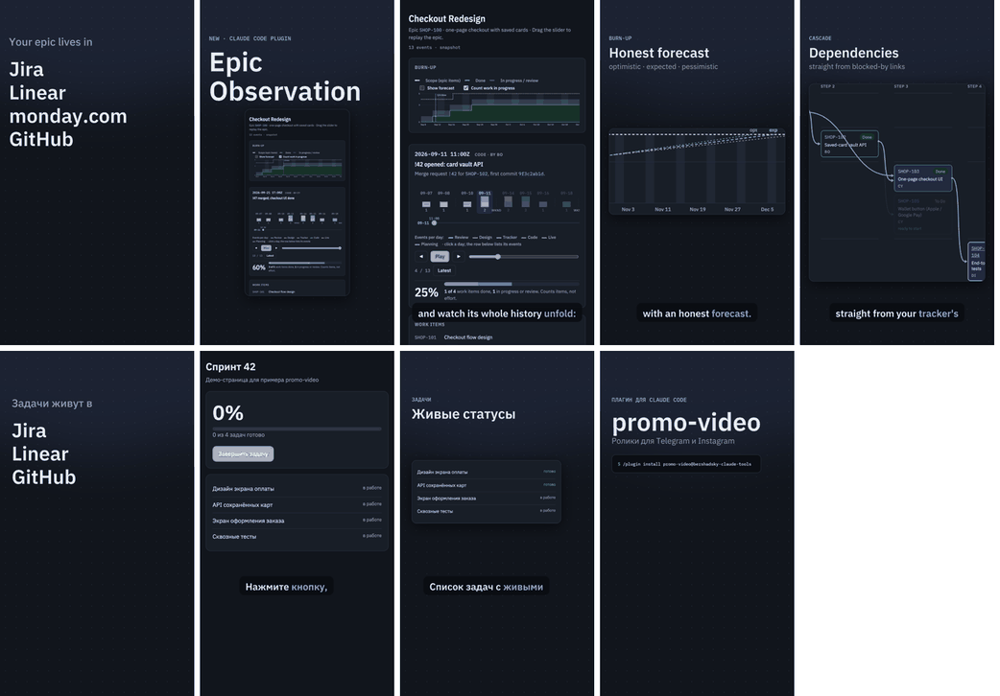

# promo-video — narrated feature videos for Telegram and Instagram

One prompt → a narrated vertical video about a feature, in Russian or English. The plugin:
- captures the **real UI** with Playwright;
- voices the script with ElevenLabs, keeping word-level timing;
- picks the best take by measurement;
- cuts scenes on the narration and renders an MP4 for each platform, with post text.



## Usage

```
/plugin marketplace add sergio-bershadsky/ai
/plugin install promo-video@bershadsky-claude-tools
```

Then ask in plain words:

- *"Сделай рилс для инстаграма и видео для телеграма про фичу из PR #21, с озвучкой на русском"*
- *"Make a 45-second Telegram promo for this plugin, English voice-over"*

The skill settles the brief (language, platforms, length, voice), studies the subject, writes the
script and a `video.json` spec, then runs the pipeline:

```bash
promo.py capture video.json          # real UI → build/video/captures/
promo.py voice   video.json          # one ElevenLabs take per model, with word timing
promo.py analyze video.json --pick   # Scribe STT error rate + pitch range → best take
promo.py stills  video.json          # contact sheets + overlap check at every cut
promo.py render  video.json          # one MP4 per target
```

## What you get

| | |
|---|---|
| Formats | `9:16` 1080×1920, `4:5` 1080×1350, `1:1` 1080×1080, H.264 + AAC, `+faststart` |
| Platforms | `telegram`, `instagram`. Instagram keeps text out of the Reels header, caption block and right button rail. |
| Scenes | `reveal` (hook), `title` (intro / CTA with install commands), `screen` (full-frame UI, replayed states, tap ripple, scroll), `spotlight` (one capture in a panning panel), `cards`, `mapping` |
| Voice | ElevenLabs `eleven_v4` and `eleven_multilingual_v2` takes. Each take is transcribed with Scribe, and words it heard wrong are listed (e.g. `bershadsky → bachinski`). |
| Captions | Word-highlighted, wrapped to width (long Russian words fit), clipped to their own scene |
| Transitions | Cuts sit in the pause between lines. A shot fades to the background before the next one fades in, so two shots never overlap. |
| Music | Optional, looped under the voice with sidechain ducking |

## Requirements

- `ffmpeg` with libx264, Python 3.10+, `pip install pillow numpy playwright`, and a Chromium
  that Playwright can use (`python3 -m playwright install chromium`).
- Fonts: IBM Plex Sans + Mono by default (`brew install --cask font-ibm-plex-sans font-ibm-plex-mono`),
  or any `.ttf` via `theme.fonts`. For Russian the fonts need Cyrillic, which `promo.py doctor` checks.
- An ElevenLabs API key in `ELEVENLABS_API_KEY`, or `voice.env_file` pointing at a file that has
  it. The key is never printed or written anywhere.

`promo.py doctor video.json` checks all of the above.

## Examples

- `skills/promo-video/examples/epic-observation/` — EN, 9 scenes, Telegram + Instagram 9:16
  (the Epic Observation launch video).
- `skills/promo-video/examples/minimal-ru/` — RU, 4 scenes, Instagram 9:16 + Telegram 1:1, with a
  self-contained demo page.

The full spec format is in [`skills/promo-video/references/spec.md`](./skills/promo-video/references/spec.md).

## Tests

```bash
python3 -m unittest discover -s plugins/promo-video/skills/promo-video/tests
```

The tests need no network. The render tests are skipped if ffmpeg, Pillow or the fonts are missing.
